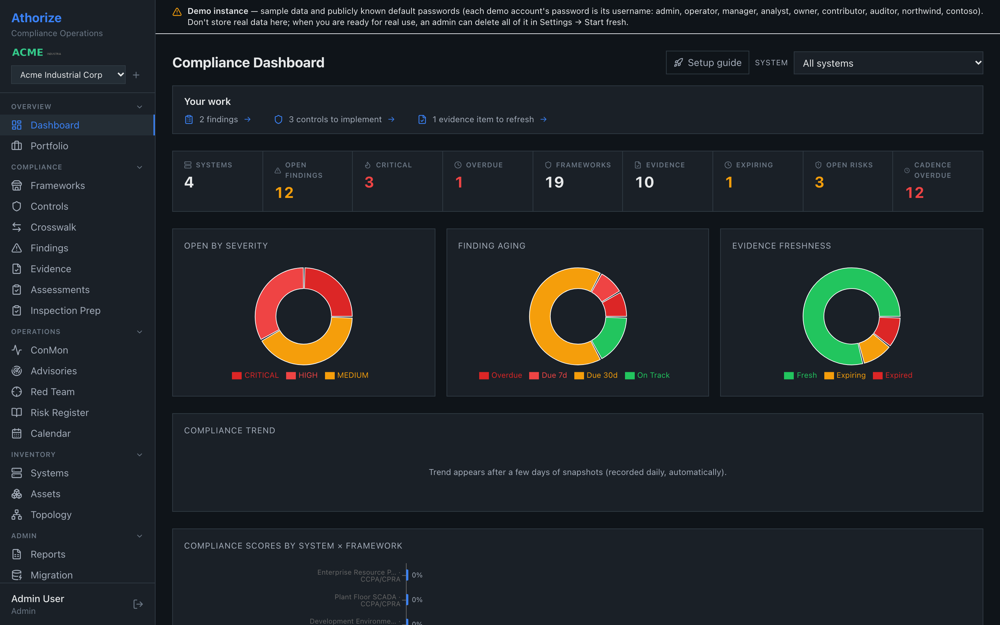
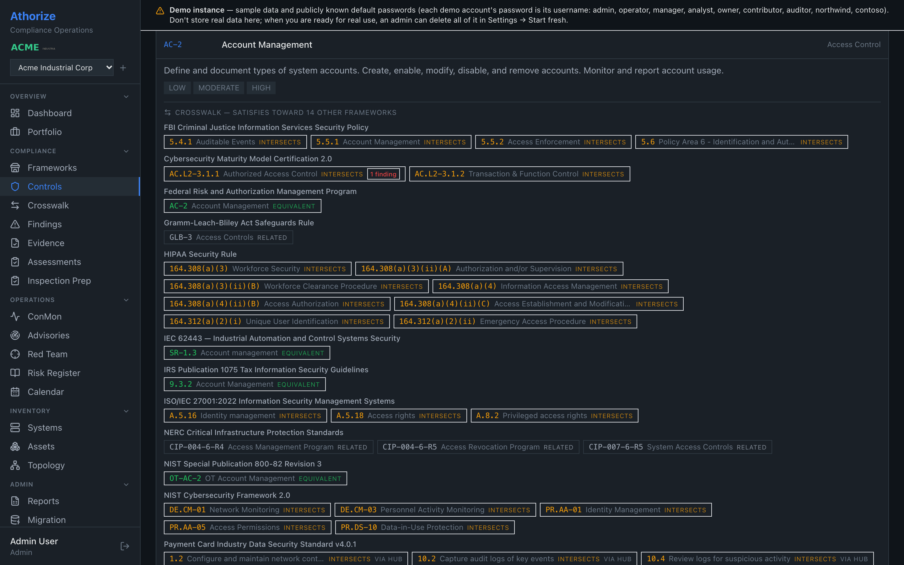
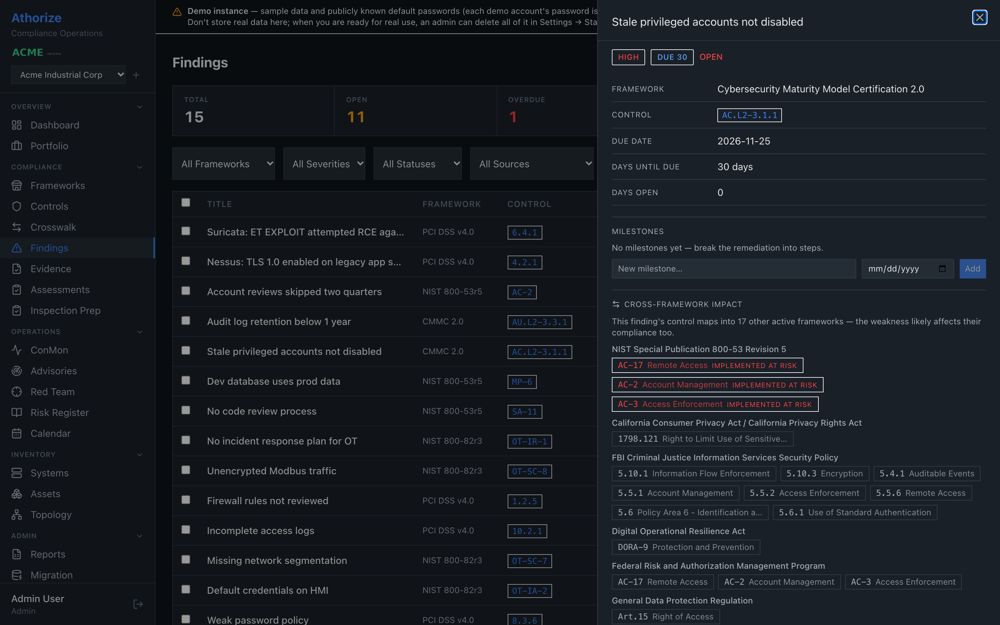
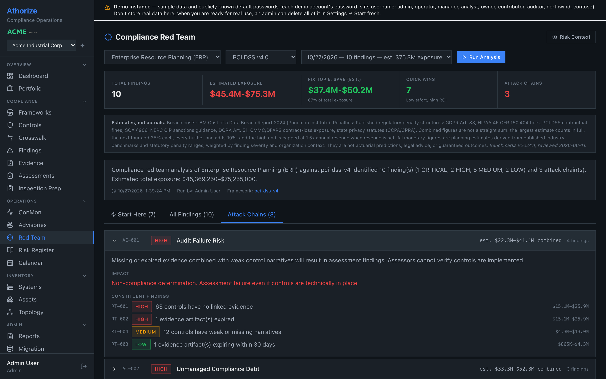

# Athorize

**Free, self-hosted compliance operations for teams that answer to more than one framework.**

Track controls, evidence, findings and audits across 18 frameworks in one place.
The crosswalk links them, so fixing a finding or uploading one piece of evidence
shows up everywhere it legitimately counts. Athorize runs on your own server or
laptop, and your compliance data never leaves it.

> Version 1.0 · free and open source ([AGPL-3.0](LICENSE)) · Docker, Linux, Windows (beta)

Created by [Douglas Cleary](https://github.com/djctwo).

All data shown is the built-in demo (fictional companies Acme, Northwind and Contoso).

| | |
|---|---|
|  |  |
| **Dashboard:** open findings, aging, evidence freshness | **Crosswalk:** one NIST 800-53 control and everything it also satisfies |
|  |  |
| **Cross-framework impact:** one finding, 17 affected frameworks | **Compliance Red Team:** 10 findings, 3 attack chains, estimated exposure in dollars |

More screenshots:
[evidence with crosswalk suggestions](docs/screenshots/04-evidence.png) ·
[Inspection Prep readiness](docs/screenshots/05-inspection-prep.png) ·
[reports and executive briefing](docs/screenshots/06-reports.png) ·
[a Red Team finding with its cost breakdown](docs/screenshots/09-red-team-finding.png) ·
[first-run setup](docs/screenshots/07-setup.png)

## Why Athorize

- **Free and open source.** AGPL-3.0, every feature included. No license keys,
  no trial limits, no paid tier.
- **Self-hosted.** It runs on your server, VM or laptop. You own the
  database, the evidence files and the backups.
- **Runs offline.** Nothing in the running app needs the internet. Framework
  catalogs and mappings ship as local files, and there is an offline install
  path for disconnected networks.
- **Your data never leaves your server.** No cloud component and no telemetry.
  Live threat feeds are off until you turn them on.
- **18 frameworks, one crosswalk.** Controls are linked through NIST SP 800-53,
  mostly using NIST's own published mappings, so work done once counts
  everywhere it applies.

## Features

- **18 frameworks, 1,077 controls:** NIST 800-53 r5, 800-82 r3 (OT), CSF 2.0,
  CMMC 2.0, FedRAMP, StateRAMP, IRS 1075, CJIS, HIPAA Security, ISO/IEC
  27001:2022, PCI DSS v4, IEC 62443, NERC CIP, GDPR, CCPA/CPRA, SOX, GLBA and
  DORA. Turn on the ones you need; build your own with the Framework Builder.
- **Crosswalk ("implement once, comply many"):** 3,494 control-to-control links,
  mostly from NIST's official mappings, routed through 800-53. Each control shows
  what it also satisfies; a finding shows every framework it affects; a review
  queue proposes status changes and never applies them silently.
- **Compliance Red Team:** reviews a system's compliance data the way a hostile
  assessor would: controls with no or expired evidence, weak narratives,
  implementation gaps, overdue or unplanned findings, missing assessments and
  past-due deadlines. Each gap comes with the affected controls (where there are
  any), remediation guidance and pre-filled finding language (one click files it),
  and related gaps link into attack chains such as Audit Failure Risk. Every gap
  carries an estimated dollar range that cites its sources (IBM/Ponemon 2024
  breach costs, statutory penalty ranges, your revenue and contract figures);
  these are planning estimates, and they feed the executive briefing. It tests
  the compliance program, not the network.
- **Evidence, findings and POA&M tracking**, with owners, due dates, comments
  and @mentions, saved views and bulk edits.
- **Continuous monitoring:** set a cadence per framework, and see what's due
  and what's stale. The calendar pulls in every deadline: finding due dates,
  milestones, evidence expiries, assessments and cadences.
- **Threat advisories** from CISA KEV, NVD, CISA advisories and vendor CSAF
  feeds, matched to your IT and OT assets and the controls they touch. Live
  feeds are opt-in; offline installs and the demo use bundled sample advisories
  about fictional vendors (labelled *Sample*).
- **Imports:** 17 finding formats: Splunk, Microsoft Sentinel, CrowdStrike,
  Elastic, Wazuh, GuardDuty, Suricata, Snort, YARA, CEF, syslog and Windows Event
  Log, plus Nessus (CSV and native `.nessus`), Qualys, Tenable and OpenVAS scan
  results. Asset inventories and POA&M/SSP spreadsheets import too.
- **Audit readiness:** an Inspection Prep score with punch list and 90/60/30
  timeline, per-assessment reports, audit binders, and an executive briefing
  (PowerPoint) for the whole company or one system and framework: posture,
  estimated exposure, open findings, crosswalk leverage, program health, a
  30/60/90 plan and recommendations, in eight sections (long tables continue
  onto extra slides).
- **Built for real teams:** six roles, per-system access, OIDC single sign-on,
  API tokens, a tamper-evident (hash-chained) audit log, and backup and restore.

## Install

### Docker (recommended)

You need Docker with the Compose plugin (Docker Desktop on macOS or Windows).

**Try the demo** (fictional data; log in as `admin` / `admin`):

```bash
git clone https://github.com/djctwo/athorize.git && cd athorize
docker compose -f docker-compose.demo.yml up -d      # then open http://localhost:8002
```

**Your own instance** (blank; opens on the Setup screen):

```bash
docker compose up -d                                 # then open http://localhost:8001
docker compose logs athorize | grep "SETUP TOKEN"    # the one-time setup token
```

The first run builds the image from source. Data lives in a Docker volume and
survives restarts and upgrades. Both are published on `127.0.0.1` only. The
demo's passwords are public, so never put real data in it. Pre-built images for
each release (amd64 and arm64) are at `ghcr.io/djctwo/athorize`; to use one
instead of building, run `ATHORIZE_IMAGE=ghcr.io/djctwo/athorize:latest docker compose up -d`.
Settings, team access behind a TLS proxy, backups and upgrades:
[docs/INSTALL.md §14](docs/INSTALL.md#14-docker-install).

### Linux server

For a team server with nginx and a system service (offline install included),
follow [docs/INSTALL.md](docs/INSTALL.md), then the
[Administrator Quickstart](docs/ADMIN_QUICKSTART.md).

To evaluate from source on a Mac or Linux laptop instead (Python 3.11+ and
Node.js 20+):

```bash
git clone https://github.com/djctwo/athorize.git && cd athorize
(cd frontend && npm ci && npm run build)
./scripts/run-eval.sh
```

Open the URL it prints. The Setup screen asks for the one-time setup token
(printed in the terminal and saved as `setup-token` in the data folder), then
offers **Set up my company** or **Explore with demo data**. Every demo account's
password is its username (admin, manager, auditor, ...); **Settings → Start
fresh** deletes the demo again. Data is kept in `~/.athorize-universal`, or in
the folder named by `ATHORIZE_DATA_DIR`.

### Windows (beta)

Download `Athorize.exe` (or `Athorize-Demo.exe`, pre-loaded with demo data) from
the [Releases page](https://github.com/djctwo/athorize/releases) and
double-click it; your browser opens to the app. The `.exe` is not code-signed,
so Windows SmartScreen shows "unknown publisher": choose **More info → Run
anyway**. The Windows app is a **beta** for trying Athorize on one computer;
for a team server, use Docker or Linux. Details: [desktop/README.md](desktop/README.md).

## Built with

FastAPI · SQLAlchemy · SQLite (PostgreSQL supported) · React 18 · TypeScript ·
Vite · Tailwind · TanStack Query · Recharts

## Framework content

Every catalog and mapping is listed with its source in
[docs/FRAMEWORK_SOURCES.md](docs/FRAMEWORK_SOURCES.md). For copyrighted
standards (ISO/IEC 27001, PCI DSS, IEC 62443, NERC CIP), Athorize ships
original plain-language summaries, not the publishers' text. Framework names
are trademarks of their owners; Athorize is not affiliated with or endorsed by
any standards body.

## Contributing and security

Bug reports and ideas are welcome as [issues](https://github.com/djctwo/athorize/issues);
see [CONTRIBUTING.md](CONTRIBUTING.md). Please report vulnerabilities privately,
as described in [SECURITY.md](SECURITY.md).

## License

Copyright © 2026 Douglas Cleary. Released under the
[GNU Affero General Public License v3.0](LICENSE): free to use, study, modify
and share. If you run a modified version for others, you must share your source
under the same license. See [NOTICE](NOTICE).

Athorize is provided without warranty. It helps you organize compliance work; it
does not certify compliance.

## Other projects

Also by Douglas Cleary: [Dojix](https://github.com/djctwo/dojix), a native Mac
forex trade journal, and [Greenwick](https://github.com/djctwo/greenwick), its
sibling for stock and day trading.
